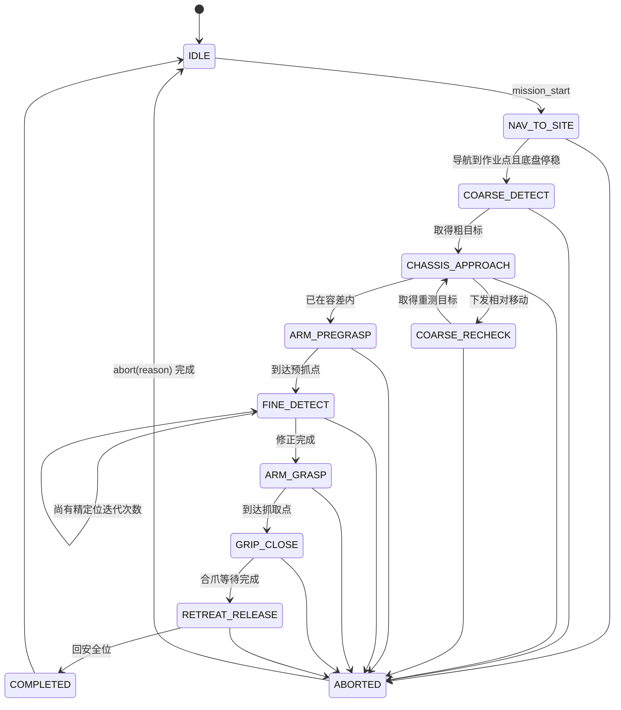

# S1–S9 复合抓取状态机

`GraspMission` 独占任务执行线程；两个 `VisionGraspNode` 均以 `provider_only=true` 运行。固定相机提供臂基座系粗目标，腕部相机提供像素和深度。所有长度均为 **mm**，姿态均为 **度**，像素基准固定为 **1280×720**。



| 状态 | 进入条件 | 动作 | 成功转移 | 失败转移 | 配置 |
|---|---|---|---|---|---|
| S1 NAV_TO_SITE | `start()` 且所有执行器空闲 | 调度/已有导航流程到作业点；任务开始后等待底盘停稳 | S2 | `abort` | 作业点由现有任务配置提供 |
| S2 COARSE_DETECT | S1 成功 | 从固定相机 provider 原子取走一条确认目标 | S3 | 服务/目标超时→`abort` | `vision.*` |
| S3 CHASSIS_APPROACH | 有粗目标 | 每次将实际下发平移前，先同步回配置安全位且成功返回，再检查 `arm_working=false`；按下式只作一次相对平移；干跑只记录计划安全位/平移 | S4 或 S5 | 回安全位/指令失败、超迭代→`abort` | `execute_*`、`approach_*`、安装外参 |
| S4 COARSE_RECHECK | S3 移动完成且停稳 | 复用固定相机 provider 重新消费目标 | S3 | 服务/目标超时→`abort` | 同 S2 |
| S5 ARM_PREGRASP | 粗目标在容差内 | 由粗抓取点及 `pregrasp_dist_mm` 计算 P；`addCartPoint` 后 `moveCartL` | S6 | 臂未连接/调用失败→`abort` | `execute_arm`、`grasp_*` |
| S6 FINE_DETECT | 已到 P | 消费腕部目标，反投影、工具系外参、姿态旋转得到修正；最多两次 | S7 | 无目标、内参无效、修正范数超限→`abort` | `fine_*`、腕部内外参 |
| S7 ARM_GRASP | S6 已完成 | `moveCartL` 到修正后的抓取点 | S8 | 调用失败→`abort` | `execute_arm`、`move_wait_ms` |
| S8 GRIP_CLOSE | 已到抓取点 | `sendRawCmd(hand_close_cmd)`；仅执行总闸与爪闸均开时动作；等待 900 ms 后置 `holding_=true` | S9 | RPC 失败→`abort` | `execute_gripper`、`hand_*` |
| S9 RETREAT_RELEASE | 已合爪或干跑 | `MoveL` 回 P → `moveToPoint` 到释放关节位 → 张爪 → 任务内实现的配置安全位 | COMPLETED | 任一步失败→`abort` | `execute_arm`、`execute_gripper`、`release_joints`、`safe_home_joints` |

## S3 数学与命令

记粗定位服务给出臂基座系目标 `p_b=[x_b,y_b,z_b]^T`（mm）。安装外参的定义为“臂基座原点在底盘中心系 C 中的位置和朝向”：`t_CB=[base_to_chassis_x_mm, base_to_chassis_y_mm,0]^T`（mm）、`ψ_CB=base_to_chassis_yaw_deg`（度）。先转为弧度 `ψ=ψ_CB·π/180`，再计算：

`p_c = t_CB + Rz(ψ) p_b`，其中 `Rz(ψ)=[[cosψ,-sinψ,0],[sinψ,cosψ,0],[0,0,1]]`。

最佳作业点仍在臂基座系：`s_b=[approach_sweet_x_mm,approach_sweet_y_mm,0]^T`。本轮应消除的平面差为 `Δ_b=[x_b-s_x, y_b-s_y]^T`，并转成底盘当前机体系方向 `Δ_c=Rz(ψ)Δ_b`。`d=||Δ_c||₂`（mm）。若 `d < approach_tolerance_mm`，不移动而进 S5；否则命令长度 `d_cmd=min(d,max_approach_step_mm)`（mm）。设 `α_math=atan2(Δ_c.y, Δ_c.x)·180/π`，实际下发角为 `α=approach_angle_sign·α_math`，其中 `approach_angle_sign` 只能取 `+1` 或 `-1`，用于匹配数学逆时针为正与控制器“前方右侧为正”的符号差异。S3 **只**下发一次纯平移：`translateDistance(α, lround(d_cmd), approach_speed_mps)`（度、mm、m/s）；不得调用 `rotateAngle`，也不得使用 `goToPose`。该符号必须先在执行总闸关闭、空载条件下验收确定；不得靠调大 `max_approach_step_mm` 绕过方向错误。

### S3 是一步精确的，迭代不是为了收敛

纯平移时所有坐标系朝向不变，因此臂基座系 B 与底盘系 C 之间只差一个固定旋转 `Rz(ψ)`。设下发的平移向量在 C 系中为 `T_c`，目标在世界系静止，则目标在 B 系中的坐标平移 `−Rz(ψ)ᵀ T_c`。令平移后正好落在最佳作业点：

```
p_b − Rz(ψ)ᵀ·T_c = s_b
        ⟹  T_c = Rz(ψ)·(p_b − s_b) = Rz(ψ)·Δ_b = Δ_c
```

即上式给出的 `Δ_c` **本身就是精确解，几何上一步到位，没有残差**。这条结论只在"不旋转"的前提下成立——一旦调用 `rotateAngle`，臂基座随之转动，`Δ_b` 当场失效，上式不再有解析解。这也是 S3 禁止旋转的根本原因。

因此 `max_approach_iterations=3` **不是收敛机制**。几何既然一步到位，需要第二步只可能出于两个原因：

1. `d > max_approach_step_mm`，单步被 400 mm 上限截断；
2. 粗定位测量噪声。

**推论（失效判据）**：若一步走完后 `d` 没有按下发量减少，则说明安装外参 `ψ`、`approach_angle_sign` 或底盘执行三者之一有系统性错误。这种错误重复迭代三次只会把同一个错误犯三遍，不会收敛。

据此替换原来的"试满三次再中止"：

```
执行前记录 d_before，S4 重测后得 d_after
预期缩减       shrink_expected = d_cmd
实际缩减       shrink_actual   = d_before − d_after

若 shrink_actual < approach_step_check_ratio · shrink_expected
   → 立即中止，原因 "底盘接近无效：安装外参或方向符号可能错误"
   → 不进入下一次迭代
```

`approach_step_check_ratio` 默认 `0.6`。方向符号取反时 `shrink_actual` 会明显为负，该判据可直接抓出上文要求空载验收的那个符号问题。`max_approach_iterations=3` 保留为兜底上限。

## S6 数学与命令

腕部 provider 输出像素 `(u,v)`（1280×720）及 `d`（米），任务类立即换算 `z_cam=1000d`（mm）。从最新 `CameraInfo.K` 缓存取得 `(fx,fy,cx,cy)`（像素）；无有效 `CameraInfo` 时使用配置兜底。反投影：

`p_cam=[(u-cx)z_cam/fx, (v-cy)z_cam/fy, z_cam]^T`（mm）。

`gripper_T_camera=[R_GC,t_GC]` 由 `gripper_to_camera_rpy_deg`（度，采用 `Rz(yaw)Ry(pitch)Rx(roll)`）及 `gripper_to_camera_translation_mm`（mm）组成，因此 `p_tool=R_GC p_cam+t_GC`（mm）。夹爪中心在工具系的标称位置为 `o_tool=tool_grasp_offset_mm`（mm）。

S5 已下发而未回读的预抓姿态为 `P=(x,y,z,roll,pitch,yaw)`；从 P 的 RPY 得 `R_P=Rz(yaw)Ry(pitch)Rx(roll)`。测得目标在基座系的位置直接为 `P_meas=P_pos+R_P·(p_tool-o_tool)`（mm），其中 `P_pos=[x,y,z]^T`。新的抓取位置直接取 `G_new=P_meas`，姿态保持 P 的 RPY，不把完整的“工具指向目标”向量再叠加到旧抓取点。守卫量是精定位相对粗定位的修正量：`correction=||G_new-G_old||₂`；若 `correction > max_fine_correction_mm=60`（mm）立即中止，绝不截断。首次迭代的 `G_old` 为粗定位结果，后续迭代的 `G_old` 为上一次 `G_new`；每次 `moveCartL` 修正后重测，最多 `fine_iterations=2` 次。

## 表面点与中心点：两个阶段共有的系统偏差

YOLO 给出的是 2D 框中心，深度给出的是**该像素处物体可见表面**到相机的距离。反投影得到的点落在物体表面上，而夹爪需要合拢在物体中心（抓瓶身即瓶轴）。中心在表面点后方约一个物体半径处。

这个偏差的量级不容忽视：500 ml 瓶身半径约 32 mm，而 `max_fine_correction_mm` 是 60 mm——**未建模偏差有守卫阈值的一半大，是当前误差链里的主导项**。

更关键的是 **S6 修不掉它**：腕部相机看到的同样是表面，带同样符号的偏差。粗定位与精定位会一致地偏近约一个半径，`correction` 反而显得很小、顺利通过守卫，然后夹爪在物体前方合拢。这是一个不会被现有任何检查捕获的失败模式。

### 补偿实现：改深度，不改三维点

沿视线方向前推 `r` 看似要在三维中做，实则不必。反投影对 `z` 是线性的，故"沿视线前推 r"等价于按比例缩放，也就等价于只调整深度标量：

```
m      = ‖[(u−cx)/fx, (v−cy)/fy, 1]‖₂     ← 视线拉伸因子，画面中心处 m = 1
z_comp = z + r / m                          （r = object_radius_mm）
```

两个阶段用同一个函数，各调用一次：

| 阶段 | 调用点 | 用途 |
|---|---|---|
| S2 / S4 粗定位 | `VisionGraspNode` 内，调 `transform_xyz` **之前**把 depth 换成 `z_comp` | 服务本身零改动 |
| S6 精定位 | `GraspMission` 内，反投影**之前** | 与上同一函数 |

**决策：补偿一律放在调用侧（本仓库），不改 legacy 工程的 `eye_to_hand.py`。** 理由不是"少动别人的仓库"——而是精定位路径根本不经过 `transform_xyz`（D5 已定 S6 不用该服务），改服务侧只能覆盖粗定位一半，S6 仍要再实现一次。调用侧一个共享函数即可两处复用，是唯一能单点覆盖全链路的位置。

`object_radius_mm` 默认 `0.0`（即不补偿），但配置注释必须写明：**取 0 意味着系统性偏近约一个物体半径**。抓 500 ml 瓶先填 `32.0`，换物体需重新量取。

该补偿只对"抓外轮廓"成立（瓶身、圆柱、球）。抓瓶口、把手或薄板时半径模型不适用，应置 0 并改用专用抓取点估计。

## 安全不变量

- 任何**实际**底盘运动前，必须由任务内的 `addJointPoint("mission_safe_home", safe_home_joints...)` 与 `moveToPoint(...)` 同步回到配置安全位且成功返回，再检查 `arm_working->load()==false`；否则不下发运动并中止。若 `execute_chassis=true` 而总闸或 `execute_arm` 未同时开启，不能证明安全位，必须中止而非平移；全关干跑只记录计划动作。现有接口没有真实反馈，这仍只是基于等待时间的证明。
- 机械臂任何 `MoveL`、关节运动和抓手动作期间，任务持有 `arm_working=true`。
- `execute_enabled=false` 时三类执行开关均无效；所有关闭的子开关只记录计划动作，不发送对应硬件指令。
- 底盘每步绝不超过 400 mm；到达 30 mm 死区后禁止继续接近。
- 精定位修正超 60 mm 必须中止；禁止限幅后继续运动。
- `move_wait_ms` 必须现场标定为所有相关 MoveL/关节轨迹耗时的上界；否则文中“等 MoveL 走完”不成立。
- 底盘每步执行后必须校验实际缩减量 ≥ `approach_step_check_ratio`×下发量；不满足即中止并报安装外参/方向符号错误，**禁止再迭代**。几何上 S3 一步精确，重复迭代无法修正系统性错误。
- 深度半径补偿必须在 S2/S4 与 S6 **两处使用同一函数、同一 `object_radius_mm`**。仅补一侧会让粗、精两阶段带不同符号的偏差，`correction` 守卫将失去意义。
- `abort(reason)` 不重试整任务；当前阻塞的 `MoveL` 返回后才回安全位；只有 `holding_==false` 才张爪；最后释放 `arm_working`、保存原因并回 IDLE。
